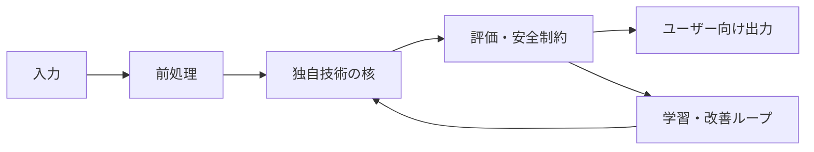

# 未踏アドバンスト提案プロジェクト詳細資料 Markdownテンプレート

- 抽出元: `志村武信_未踏アドバンスト提案プロジェクト詳細資料_260323.pdf`
- 抽出・確認日: 2026-08-16
- 用途: 2026年度下期 未踏アドバンスト応募の詳細資料をMarkdownで組み立てるための下書き
- 注意: 抽出元は14ページの提案例であり、現行公募のページ数・文字サイズ・提出形式を保証する様式ではない。提出前に最新の公募要領を優先して調整する。

## このテンプレートの使い方

- `[記入]`、`[数値]`、`[URL]`、`[図]` を具体的な内容へ置き換える。
- 外部情報は確認日または発表年とURLを付ける。
- 本文では、必要に応じて `【確認済み】`、`【情報源からの推論】`、`【チームの仮説】` を使い分ける。
- 「市場が大きい」「AIを使う」より先に、技術仮説、自作範囲、現状の証拠、比較条件を書く。
- 図は最低でも「システム構成」「現状デモ」「開発線表」の3点を候補とする。

---

# [30字以内を目安にしたプロジェクト名]

未踏アドバンスト提案プロジェクト詳細資料  
提案者名：[氏名1、氏名2、氏名3]

## 1. プロジェクト概要

> 目安: 課題、対象者、技術核、作るもの、8か月後の到達点、社会・事業への効果を、単独で読める形にまとめる。公開概要600〜1,000字へ転用できる密度にする。

[誰がどの場面で、何に困っているか。]

[従来方式では解けない理由。]

[本プロジェクトで開発する技術。モデル、アルゴリズム、ランタイム、データ、ハードウェアのうち自作する核を明示する。]

[入力→処理→出力を一文で書く。]

[事業期間中の代表デモと定量KPI。]

[終了後に誰へどの形で提供し、どの社会・産業変化へつなげるか。]

## 2. プロジェクトの背景、目的、目標

### 提案背景

#### 確認済みの事実

- [現場・市場・社会課題の事実。数値、年度、URL]
- [既存手段の利用状況、費用、時間、失敗率等]
- [技術動向。一次情報と確認日]

#### 情報源からの推論

- [上記事実から、なぜ今この技術が必要と考えるか]

#### チームの仮説

- [まだ外部検証できていないが、本プロジェクトで検証する前提]

### 目的

[開発目的]  
[事業化または社会実装の目的]

### 目標

| 区分 | 現状値 | 期間中目標 | 測定条件・比較対象 |
|---|---:|---:|---|
| 技術KPI 1 | [数値/未測定] | [数値] | [データ、端末、環境] |
| 技術KPI 2 | [数値/未測定] | [数値] | [ベースライン] |
| 実証KPI | [件数] | [件数] | [対象者、利用期間] |
| 事業KPI | [件数/金額] | [件数/金額] | [契約・LOI・有償PoC等の定義] |

### 入力・処理・出力

- 入力: [データ、要求、センサ信号等]
- 処理: [主要な技術段階]
- 出力: [ユーザーが得る結果、制御信号、データ形式等]

## 3. 競合及び競合との差別化要因

### 競合の定義

- 直接競合: [同じ顧客・同じ用途の製品]
- 技術競合: [同じ技術課題を解く研究・OSS・API]
- 代替手段: [人手、既存ワークフロー、導入しない選択]
- 近接する未踏採択案件: [案件名、年度、URL、非重複の一文]

### 同条件比較

| 比較軸 | 本プロジェクト | 競合A | 競合B | 現行の手作業 |
|---|---|---|---|---|
| 対象ユーザー・現場 | [記入] | [記入] | [記入] | [記入] |
| 技術構成 | [記入] | [記入] | [記入] | [記入] |
| 定量性能 | [記入] | [記入] | [記入] | [記入] |
| 未解決点 | [記入] | [記入] | [記入] | [記入] |
| 自作範囲 | [記入] | - | - | - |
| 模倣困難性 | [記入] | [記入] | [記入] | [記入] |

### 差別化の要約

[競合が採るアーキテクチャでは達成しにくい理由と、本方式で初めて可能になる能力を一段落で書く。]

## 4. ユニークインサイト

### 現場観察・顧客インタビューから得た知見

- 対象者: [属性。個人名は公開許諾がある場合のみ]
- 実施日: [YYYY-MM-DD]
- 現在の作業: [具体的な手順]
- 切迫度: [頻度、損失、事故、工数、費用]
- 既存代替: [現在どうしのいでいるか]
- 発見: [チームが現場を見るまで分からなかったこと]

### 技術的インサイト

[既存研究・製品が暗黙に置く前提と、その前提が現場では崩れる理由。]

### 設計パートナー・利用者の声

> [25語以内の短い引用または要約。発言日、所属、公開許諾を確認]

### このインサイトが製品・技術設計をどう変えるか

[機能、評価条件、データ収集、販売方法への反映。]

## 5. 開発に関する未踏性の主張、期待される効果

### 既存技術の課題

[既存方式の処理構造を説明し、どこが原理的・実務的な限界かを書く。]

### 本プロジェクトの技術的未踏性

1. [新しいモデル・アルゴリズム・表現]
2. [新しいシステムプリミティブ・ランタイム]
3. [独自データ・実世界制約・ハードウェア]
4. [再現可能な評価方法]

### 最大の技術仮説

> [「Xを実現すれば、Y条件でもZを達成できる」の形で反証可能に書く。]

### 期待される効果

- 直接効果: [対象ユーザーの時間、費用、安全、品質]
- 技術波及: [他領域へ展開できる新しい能力]
- 事業効果: [収益・利用拡大・データ蓄積]
- 社会的効果: [安全、人手不足、災害、環境等]

## 6. 開発の具体的な進め方

### 現状の開発基盤と実績

| 証拠 | 現在地 | URL・添付 | 応募時までの更新 |
|---|---|---|---|
| 動くプロトタイプ | [記入/未確認] | [URL] | [記入] |
| 定量ベンチマーク | [記入/未測定] | [URL] | [記入] |
| 独自データ | [記入/未確認] | [URL] | [記入] |
| 顧客・実証合意 | [記入/未確認] | [URL] | [記入] |

### システム構成

### 開発項目

1. **[開発項目1]**
   - 開発内容: [記入]
   - 担当: [氏名]
   - 成果物: [コード、モデル、データ、実機]
   - 合格条件: [定量KPI]
2. **[開発項目2]**
   - 開発内容: [記入]
   - 担当: [氏名]
   - 成果物: [記入]
   - 合格条件: [記入]
3. **[開発項目3]**
   - 開発内容: [記入]
   - 担当: [氏名]
   - 成果物: [記入]
   - 合格条件: [記入]

### 克服すべき課題と解決策

| 課題・失敗モード | 発生条件 | 検知方法 | 解決仮説 | 代替策・縮退運転 |
|---|---|---|---|---|
| [課題1] | [記入] | [記入] | [記入] | [記入] |
| [課題2] | [記入] | [記入] | [記入] | [記入] |

## 7. 未踏期間中の開発計画

| 期間 | 開発内容 | マイルストーン | 評価・顧客検証 | 主担当 |
|---|---|---|---|---|
| 第1期（1〜2か月目） | [記入] | [成果物] | [測定・面談] | [氏名] |
| 第2期（3〜5か月目） | [記入] | [成果物] | [測定・実証] | [氏名] |
| 第3期（6〜8か月目） | [記入] | [成果物] | [最終比較・契約] | [氏名] |

### Go/No-Go条件

- [期限]: [条件を満たさなければ対象・機能を縮小する]
- [期限]: [実機・顧客評価が不成立なら代替検証へ切り替える]

### 予算の考え方

- 各人の月別稼働時間: [記入]
- 委託費見積: [記入]
- クラウド・GPU・設備等: [自己負担、協力先、既存資産を明記]
- 外部資金・他助成との重複: [有無、切り分け]

## 8. プロジェクトメンバー及び協力体制

### プロジェクトメンバーの経歴

#### [氏名1]

- 所属・学歴: [本人申告。応募時に正式確認]
- 技術実績: [成果物とURL]
- 本件に直結する能力: [記入]
- 期間中の稼働: [月別時間]
- 担当成果物: [記入]

#### [氏名2]

[同上]

### 本プロジェクトを始めた動機

[なぜこの問題へ長期的に取り組むのか。個人的経験と技術課題を接続する。]

### 役割分担

| メンバー | 固有担当 | 期間中の成果物 | 稼働 | 不在時に成立しない理由 |
|---|---|---|---:|---|
| [氏名] | [記入] | [記入] | [時間/月] | [記入] |

### 協力体制

- 設計パートナー: [企業・組織、協力内容、合意状況]
- データ提供: [範囲、権利、利用条件]
- 実証設備: [設備、利用時期、責任者]
- 専門家: [役割、公開可否]

### 所属組織・既存事業との境界

[個人応募であること、コード、知財、顧客、設備、稼働、経費をどう分離するか。]

## 9. 事業化・社会実装の新規性・優位性、想定するターゲットと規模

### 想定顧客と最初の狭い市場

- 利用者: [実際に操作する人]
- 支払者: [予算を持つ人・組織]
- 最初の用途: [具体的な一業務]
- 導入単位: [端末、拠点、席、API、年間契約等]
- 現在の代替費用: [人件費、事故損失、既存製品費]

### 市場規模

[TAM/SAM/SOMは算定式、単価、顧客数、年度、出典を明記する。政策や市場レポートだけでニーズの証明を代替しない。]

### 事業化・社会実装の新規性や優位性

[技術、データ、現場アクセス、導入フロー、規制適合等の堀。]

### 収益・提供モデル

- 提供形態: [SDK、ランタイム、端末、SaaS、ライセンス等]
- 価格仮説: [金額と根拠]
- 販売経路: [設計パートナー、代理店、直接販売等]
- 粗利・主要原価: [推論、保守、ハード等]

### 事業期間中の顧客開発

| 時期 | 対象 | 検証内容 | 成功条件 |
|---|---|---|---|
| [月] | [顧客群] | [課題インタビュー] | [件数・基準] |
| [月] | [設計パートナー] | [PoC] | [KPI] |
| [月] | [支払者] | [有償化] | [契約条件] |

### 克服すべき事業課題と解決策

1. [導入障壁] → [解決策]
2. [データ・知財・安全責任] → [解決策]
3. [販売・保守] → [解決策]

## 10. 事業期間終了後の事業化・社会実装に関する計画

### 終了直後（0〜12か月）

[人員、開発継続、契約、売上、運用体制。]

### 中期（1〜3年）

[対象拡大、標準化、海外展開、採用、資金調達。]

### 継続に必要な人員・経費

| 項目 | 必要量 | 年間費用 | 調達方法 |
|---|---:|---:|---|
| 人員 | [人月] | [円] | [売上/資金調達等] |
| 計算資源・設備 | [量] | [円] | [記入] |
| 実証・保守 | [量] | [円] | [記入] |

## 参考資料

- 自己紹介動画: [URL]
- プロトタイプ動画: [URL]
- コード・デモ: [URL]
- LOI・協力確認: [添付名]

## 参考文献

1. [著者・組織、資料名、発表年、URL、確認日]
2. [同上]

## 提出前チェック

- [ ] 現行公募要領のページ数、文字サイズ、ファイル形式に適合した
- [ ] プロジェクト名が応募フォームの字数制限内
- [ ] 全メンバーが実際の開発者で、固有担当・稼働・成果物を説明できる
- [ ] 企業・研究室・個人応募の知財、コード、顧客、稼働、経費を分離した
- [ ] 既存採択案件と主要競合との差を各1文で説明した
- [ ] KPIに現状値、目標値、測定条件、比較対象がある
- [ ] プロトタイプ、比較結果、顧客証拠のURLまたは添付がある
- [ ] 外部情報に年度または確認日とURLがある
- [ ] 「確認済みの事実」「情報源からの推論」「チームの仮説」を混同していない
