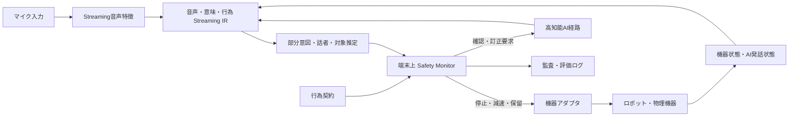

# 物理AIの委任を撤回・訂正する音声安全基盤の開発

未踏アドバンスト提案プロジェクト詳細資料  
提案者名：小幡有生、松川直生、白石雄太郎（全員、参加・正式表記・所属・稼働を要確認）

> ステータス: 2026-08-16 骨子ドラフト v0.1  
> 現在の本命案: `Voice Safety Kernel for Physical AI`  
> 記述方針: 未確認事項を補完した完成稿ではなく、検証すべき空欄を残した申請書の骨組みである。  
> 主な根拠資料: [応募メモ](../MEMO.md)、[アイデアランキング](../research/yc-s26-team-idea-ranking-2026-08-13.md)、[採択傾向と音声AI評価](../research/mitou-advanced-trends-2026-08-12.md)

## 1. プロジェクト概要

AIエージェントやロボットへ自然言語で作業を委任できるようになる一方、いったん開始された物理行為は、画面上の生成結果と異なり簡単には巻き戻せない。現在の音声操作は、音声認識結果を確定し、LLMが意味を解釈し、制御命令へ変換する直列処理が中心である。この構造では、人がAIの発話へ重ねて「違う」「それではなく青」「止まって」と訂正しても、確定処理を待つ間に機器が行為を続ける可能性がある。

本プロジェクトでは、人、AI、機器が同時に動く現場で、実行中の委任を音声で即時に撤回・訂正するための `Voice Safety Kernel` を開発する。音声・意味・物理行為を連続時間上で扱うストリーミング中間表現、停止期限や再確認条件を記述する「行為契約」、高知能なクラウドAIと分離して端末上で決定論的に動くSafety Monitorを自作する。部分発話の段階から停止・訂正候補を検知し、確信度に応じて停止、減速、確認、再開を切り替える。

代表デモでは、ロボットアームまたは移動機器が対象へ動作中に、利用者が重複発話で停止・対象変更を指示する。一般的なASR→LLM→制御方式と、停止遅延、停止見逃し、誤停止、訂正完了率を同条件で比較する。騒音、エコー、通信断、複数話者を加えたHIL（Hardware-in-the-Loop）環境でも評価し、2種類の機器で再現可能なベンチマークとSDKを公開可能な範囲で整備する。

最初の顧客は、自然言語操作をロボット・産業機器へ組み込みたい開発企業を想定する。事業期間中に設計パートナーとの実機検証を行い、終了後は安全制御ランタイム、評価キット、組込み支援を提供する。目指すのは「AIが誤らない」ことではなく、人が実行中でも委任を撤回・訂正できることを、物理AIの共通プリミティブにすることである。

## 2. プロジェクトの背景、目的、目標

### 提案背景

#### 確認済みの事実

- 人間の自然会話では短いターン遷移を実現するため、相手の発話中から理解と応答準備が進む。直列型の「発話終了→認識→推論→応答」だけでは、この並行性を再現しにくい。[Levinson & Torreira, 2015](https://pmc.ncbi.nlm.nih.gov/articles/PMC4464110/)（確認日: 2026-08-12）
- Moshiは2024年にfull-duplex音声対話と約200ms級の実動作レイテンシを示した。したがって、低遅延だけを未踏性の中心には置けない。[Moshi, 2024](https://arxiv.org/abs/2410.00037)（確認日: 2026-08-12）
- Instruct-FDは2026年、full-duplexシステムのターンテイキング指示追従を評価し、リポジトリ調査時点の最良モデルでも遵守率64.4%と報告している。[Instruct-FD, 2026](https://arxiv.org/abs/2607.20460)（確認日: 2026-08-12）
- 直近の未踏アドバンストには、エージェンティック音声入力と物理AI基盤の近接案件がある。本案は、文章編集や実行前後の説明責任ではなく、不可逆な物理行為を実行中に中断・訂正する制御を対象とする。[エージェンティック音声入力](https://www.ipa.go.jp/jinzai/mitou/advanced/2026first/gaiyou-fj-2.html)、[物理AI基盤](https://www.ipa.go.jp/jinzai/mitou/advanced/2026first/gaiyou-kj-2.html)（確認日: 2026-08-13）

#### 情報源からの推論

- 低遅延音声モデルの進歩により、音声をロボット制御へ接続する条件は整いつつある。一方、用途ごとの停止・訂正ルールを確実に守る制御層は未成熟であり、音声AIの知能と物理安全を分離・統合するシステム技術に余地がある。
- 既存の非常停止は強力だが、対象変更、直前の委任撤回、条件付き再開などの意味を扱わない。LLMに全判断を任せる方式と、意味を扱わない非常停止の間に、新しいランタイム層が必要である。

#### チームの仮説

- 人の訂正を「完成した文章」ではなく、時間制約付きの制御イベントとして扱えば、重複発話中でも高知能モデルの応答を待たずに安全側へ遷移できる。
- 停止、減速、確認、再開を形式化した行為契約は、異なる機器へ移植できる共通プリミティブになる。
- 最初の用途は、ロボットアームまたは移動機器の一作業に絞る。対象機器と実証先は未確定であり、応募前に固定する。

### 目的

開発目的は、音声による停止・訂正を部分発話の段階から検知し、端末上のSafety Monitorを介して物理行為へ期限内に反映する共通ランタイムを実現することである。

事業化目的は、自然言語操作を実機へ導入したい企業が、個別に安全機構と評価環境を作り直さずに済むSDK・評価キットを提供することである。

### 目標

数値は応募前ベンチマークで現状値を測定したうえで確定する。以下は反証可能な暫定目標である。

| 区分 | 現状値 | 期間中の暫定目標 | 測定条件・比較対象 |
|---|---:|---:|---|
| 停止指示から安全出力までの遅延 | 未測定 | p95 100ms以下 | 端末内経路。一般的なASR→LLM→制御と比較 |
| 停止見逃し率 | 未測定 | 1%以下 | 騒音・エコー・重複発話を含む事前登録データ |
| 誤停止率 | 未測定 | 5%以下 | 通常会話と機器指示を混在させた評価 |
| 訂正完了率 | 未測定 | ベースライン比20ポイント以上改善 | 対象変更、数量変更、停止後再開のシナリオ |
| 機器間移植性 | 0機器 | 2種類の実機 | 共通行為契約を用い、機器アダプタのみ交換 |
| 設計パートナー | 0件（未確認） | 実証意向2件、実機PoC 1件以上 | 協力範囲と評価KPIを文書化 |

### 入力・処理・出力

- 入力: マイク音声、AIの発話状態、実行中の行為状態、機器からの安全・位置・速度情報
- 処理: full-duplex音声処理 → 部分意図推定 → 行為契約照合 → Safety Monitor → 機器アダプタ
- 出力: 停止、減速、保留、対象変更要求、再確認、再開等の決定論的な制御イベントと監査ログ

## 3. 競合及び競合との差別化要因

### 競合の定義

- 直接競合: ロボット・機器向け自然言語操作SDK、音声インターフェース
- 技術競合: 低遅延full-duplex音声モデル、クラウドRealtime API、ストリーミングASR
- 代替手段: 物理ボタン式の非常停止、定型コマンド認識、操作者による常時監視、自然言語操作を採用しない判断
- 近接採択: エージェンティック音声入力、物理AI基盤、常時LLM対話。本案は「実行中の物理行為へ期限付きで反映する撤回・訂正意味論」を中心にする。

### 同条件比較

| 比較軸 | Voice Safety Kernel | ASR→LLM→制御 | full-duplex音声モデル | 物理非常停止 |
|---|---|---|---|---|
| 部分発話中の停止 | 対象 | 原則、認識・解釈完了待ち | 会話停止は可能でも機器制御保証は別 | ボタン操作で可能 |
| 意味を伴う訂正 | 対象変更・条件変更を行為契約で扱う | LLM解釈に依存 | 会話方針に依存 | 扱わない |
| クラウド断 | 安全経路は端末内で継続 | 構成に依存 | 構成に依存 | 継続 |
| 決定論的期限 | 行為契約で明示 | 原則保証なし | 原則保証なし | 機器仕様で保証 |
| 自作範囲 | Streaming IR、行為契約、Safety Monitor、HIL評価 | - | - | - |
| 主な弱点 | 音声誤検知と意味曖昧性 | 遅延と不確実性 | 指示追従と外部制御の保証 | 柔軟な訂正ができない |

### 差別化の要約

本案は音声認識モデルそのものやロボット制御器を置き換えるのではなく、その間に「人が実行中の委任を撤回・訂正する」ための共通制御層を設ける。低遅延モデルの出力をそのまま信頼せず、行為の危険度、期限、確認条件を形式化し、端末上で安全側の制御へ変換する点を差別化の中心とする。

## 4. ユニークインサイト

### 現時点のインサイト

#### 確認済みの事実

- full-duplex音声対話では、自然な割り込みが可能になりつつある一方、明示したターンテイキング方針への追従は未解決である。
- 物理行為は、文章生成のように出力後へ編集履歴を適用するだけでは被害を取り消せない。

#### 情報源からの推論

- 物理AIの安全性では、AIが正解する確率だけでなく、人が介入してから安全状態へ移るまでの時間と失敗率を独立に測る必要がある。
- 音声UIは「命令文を認識する入口」ではなく、委任の開始、保留、訂正、撤回、再開を扱う時間的プロトコルとして再設計すべきである。

#### チームの仮説

- 「止まって」のような緊急語だけでなく、「違う、赤ではなく青」のような訂正も、行為状態と組み合わせれば限定された形式意味へ落とせる。
- すべてをLLMへ任せず、Safety Monitorが扱う語彙と行為契約を狭く保つことで、柔軟性と決定論性を両立できる。

### 応募前に取得する現場知見

- ロボット・機器開発者10件へ、現在の音声操作、停止経路、事故・ヒヤリハット、認証上の障壁を聞く。
- 少なくとも2社と、対象作業、使用機器、現在の失敗、評価協力範囲を具体化する。
- ここへ設計パートナーの発言要約を、発言日と公開許諾付きで追加する。

### このインサイトが設計をどう変えるか

- 高知能経路と安全経路を分離し、通信断でも安全経路を維持する。
- 音声だけで断定せず、行為状態、対象候補、話者、物理センサを併用する。
- 「停止できた成功例」だけでなく、誤停止、停止見逃し、誤訂正の失敗動画とログを公開可能な範囲で残す。

## 5. 開発に関する未踏性の主張、期待される効果

### 既存技術の課題

既存の音声操作は、認識結果を完成したテキストとしてLLMへ渡し、得られた命令を機器へ送る構成が多い。この構成は汎用性が高いが、物理行為の危険度と音声処理の遅延を同じ制御モデルで扱わず、クラウド推論の変動も受ける。逆に、従来の非常停止は期限と信頼性を設計できるが、「どの対象へ変えるか」「どの条件なら再開するか」といった意味的訂正を扱えない。

### 本プロジェクトの技術的未踏性

1. **音声・意味・行為のStreaming IR**: 未確定の部分音声、話者、確信度、対象候補、機器状態を同じ時間軸で更新する。
2. **行為契約**: 「停止は100ms以内」「対象変更は再確認」「通信断時は減速」等を、機器から独立した形式で記述する。
3. **端末上Safety Monitor**: クラウドAIの出力を安全境界として使わず、行為契約を決定論的に評価して制御イベントを発行する。
4. **投機的訂正と確定処理の統合**: 部分発話で安全側へ一時遷移し、後続発話で訂正内容を確定する。
5. **再現可能なHIL評価**: 騒音、エコー、重複発話、複数話者、通信断、なりすましを含む失敗条件を事前登録し、2種類の機器で比較する。

### 最大の技術仮説

> 部分発話と行為状態を連続時間で統合し、端末上の行為契約へ照合すれば、クラウドLLMの応答を待たずに物理行為を安全側へ遷移させながら、その後の意味的な訂正まで完了できる。

この仮説は、停止遅延だけを短くしても誤停止・見逃しが増える場合、または機器間で契約を再利用できない場合に反証される。

### 期待される効果

- 直接効果: 自然言語操作の導入時に、実行中の訂正不能というリスクを減らす。
- 技術波及: ロボット、移動機器、遠隔操作、スマート設備へ共通の委任・撤回プリミティブを提供する。
- 事業効果: 機器企業が個別の音声安全層と評価環境を作る工数を削減する。
- 社会的効果: 身体を持つAIへ作業を委任する社会で、人間が最終的な介入権を保持できるようにする。

## 6. 開発の具体的な進め方

### 現状の開発基盤と実績

#### 確認済みの事実

- リポジトリ内には技術構想、競合整理、評価計画がある。
- チーム候補には音声AI・機械学習の研究開発経験があるとの本人申告がある。
- 本案の動作コード、実機デモ、同条件ベンチマーク、設計パートナーは、このリポジトリでは未確認である。

| 証拠 | 現在地 | 応募時までの最低到達点 |
|---|---|---|
| 動くプロトタイプ | 未確認 | 1機器で停止・訂正を実演する30秒動画 |
| 定量ベンチマーク | 未測定 | 20以上の失敗シナリオでベースライン比較 |
| 独自データ | 未確認 | 日本語の重複発話・騒音・訂正データと収集条件 |
| 顧客・実証合意 | 未確認 | 実証意向2件、対象作業を明記した協力確認 |

### システム構成

### 開発項目

1. **Streaming IRと日本語訂正データ**
   - 内容: 部分音声、重複発話、話者、対象候補、行為状態の時刻同期表現を設計する。
   - 暫定担当: 小幡有生
   - 成果物: スキーマ、ストリーミング実装、評価データ、ベースライン
   - 合格条件: 主要な停止・対象変更・取消シナリオを欠落なく表現できる。
2. **行為契約とSafety Monitor**
   - 内容: 期限、危険度、確認条件、縮退動作を記述し、端末上で決定論的に評価する。
   - 暫定担当: 松川直生
   - 成果物: 契約言語、ランタイム、機器アダプタ、形式・プロパティテスト
   - 合格条件: クラウド断時にも期限内の停止を維持し、再現試験に合格する。
3. **部分意図推定とHIL評価**
   - 内容: 騒音・エコー・重複発話下の部分意図推定、失敗注入、同条件比較を実装する。
   - 暫定担当: 白石雄太郎
   - 成果物: 推定モデル、HILハーネス、評価レポート、失敗動画
   - 合格条件: 事前登録した条件で停止遅延・見逃し・誤停止・訂正完了率を報告できる。

> 役割分担は本人の実績・希望・稼働を確認後に確定する。現時点の割当は申請書構造を作るための仮置きである。

### 克服すべき課題と解決策

| 課題・失敗モード | 検知方法 | 解決仮説 | 代替策・縮退運転 |
|---|---|---|---|
| 騒音で停止語を見逃す | 信号品質・複数モデル不一致 | 音響特徴と行為状態を統合 | 速度制限、物理E-stopを併用 |
| 通常会話を誤って停止と解釈 | 話者・宛先・行為文脈 | 宛先推定と二段階状態遷移 | 一時保留後に確認 |
| 「違う」の対象が曖昧 | 対象候補が複数 | 行為契約で確認を必須化 | 再開せず安全状態を維持 |
| クラウドAIが応答不能 | タイムアウト・通信断 | 安全経路を端末へ分離 | 定型音声で状態を通知 |
| 機器ごとに制御が異なる | アダプタ適合試験 | 共通イベント＋機器固有変換 | 対象機器を2種類に限定 |

## 7. 未踏期間中の開発計画

事業期間は約8か月を前提とする。正式な契約期間に合わせて月表記を更新する。

| 期間 | 開発内容 | マイルストーン | 評価・顧客検証 | 主担当 |
|---|---|---|---|---|
| 第1期（1〜2か月目） | 対象作業固定、失敗データ収集、Streaming IR、単一機器アダプタ | 停止だけを期限内に実行するv0 | 20シナリオ、設計パートナー2件 | 小幡・松川 |
| 第2期（3〜5か月目） | 行為契約、訂正・再開、端末実装、HIL失敗注入 | 停止・対象変更・再確認を含むv1 | ASR→LLM方式との同条件比較 | 全員 |
| 第3期（6〜8か月目） | 2機器目への移植、現場PoC、SDK・評価キット整備 | 再現可能なv2と実機デモ | 実機PoC、外部開発者テスト | 全員 |

### Go/No-Go条件

- 2か月目: 停止遅延と見逃し率がベースラインを改善しなければ、意味的訂正より先に音響・端末経路を再設計する。
- 4か月目: 行為契約が1機器でしか成立しない場合、汎用SDKを主張せず、対象機器専用ランタイムへ範囲を縮小する。
- 6か月目: 実証先が確保できない場合、公開可能な実機ベンチと第三者開発者評価を代替証拠とする。ただし応募前に最低1件の実証アクセスを優先して確保する。

### 予算の考え方

- 委託費は各人の実作業時間に基づき算出する。月別稼働は全員未確認。
- ロボット、端末、GPU、収録環境の利用可能資産と自己負担範囲は未確認。
- 小幡氏の既存音声AI事業と、コード、顧客、知財、稼働、経費を分離する。
- 詳細予算は、正式メンバーと月別稼働を確定後に作成する。

## 8. プロジェクトメンバー及び協力体制

以下は2026-08-12時点の本人申告であり、応募時に正式確認する。

### プロジェクトメンバーの経歴

#### 小幡有生（代表候補）

- 筑波大学附属駒場高等学校、早稲田大学学部を卒業。
- 東京大学大学院・染谷研究室を休学中。
- 音声AI領域で起業。
- 本件に直結する公開可能なモデル、コード、顧客実績、デバイス実績は未確認。

#### 松川直生

- 筑波大学附属駒場高等学校、東京大学学部を卒業。
- 東京大学大学院の機械学習系研究室に所属との本人申告。
- 研究テーマ、コード、論文、実機開発実績、稼働は未確認。

#### 白石雄太郎

- 筑波大学附属駒場高等学校、東京大学学部を卒業。
- 東京大学大学院で機械学習を研究との本人申告。
- 研究テーマ、コード、論文、評価基盤の実績、稼働は未確認。

### 本プロジェクトを始めた動機

[要本人記入] 音声AIをサービスとして実装する中で、どのような失敗や顧客要望から「実行中の委任を撤回・訂正する」課題へ至ったかを書く。学歴や流行ではなく、継続して取り組む理由と過去の具体的な開発を接続する。

### 役割分担

| メンバー | 暫定担当 | 期間中の成果物 | 稼働 | 確認事項 |
|---|---|---|---:|---|
| 小幡有生 | Streaming IR、音声処理、全体統合 | 音声ランタイム、実機統合 | 未確認 | 既存会社との知財・事業境界 |
| 松川直生 | 行為契約、Safety Monitor | 契約言語、端末ランタイム | 未確認 | システム・組込み実績 |
| 白石雄太郎 | 部分意図推定、データ、HIL評価 | モデル、ベンチ、評価レポート | 未確認 | 研究テーマ・実装実績 |

### 協力体制

- 設計パートナー: ロボットまたは機器開発企業2社を目標。現時点では未確認。
- 実証設備: ロボットアームまたは移動機器を使用できる環境が必要。現時点では未確認。
- 音声データ: 独自利用可能な日本語の重複発話・騒音データは未確認。
- 4人目を加える場合は、回路・音響ハード・組込み等の不可欠な固有担当と稼働を説明できる人物に限る。

### 所属組織・既存事業との境界

個人または個人チームとして応募する。小幡氏の会社、各人の研究室・勤務先について、背景知財、既存コード、顧客、設備、秘密情報、勤務時間、競業、成果知財の帰属を応募前に一覧化し、必要な承諾を得る。本プロジェクト固有のコードリポジトリ、契約、経費、顧客合意を分離する。

## 9. 事業化・社会実装の新規性・優位性、想定するターゲットと規模

### 想定顧客と最初の狭い市場

- 利用者: ロボット・産業機器へ自然言語操作を組み込むソフトウェア／制御開発者
- 支払者: 機器メーカー、ロボットSIer、実証を行う事業部門
- 最初の用途: [要決定] ロボットアームの対象選択・停止、または移動機器の進路変更・停止
- 導入単位: 機器シリーズ単位のSDKライセンス＋HIL評価・組込み支援
- 現在の代替費用: 個別の音声UI開発、安全評価、操作者配置の工数。金額は顧客インタビューで確認する。

### 市場規模

現時点では市場規模を置かない。応募前に、自然言語操作を計画する機器企業数、1機種あたりの安全統合・評価工数、想定ライセンス単価からボトムアップで算定する。ロボット市場全体の金額を、そのまま本案の獲得可能市場とはみなさない。

### 事業化・社会実装の新規性や優位性

- モデル非依存: 特定のクラウドAIを置き換えず、安全経路を追加できる。
- 実機で蓄積する失敗データ: 騒音、通信断、重複発話、誤停止を含む再現ベンチを堀にする。
- 行為契約: 機器ごとに散在する停止・確認ルールを共通表現へ変える。
- 端末実装: 安全に必要な最短経路をクラウドから切り離す。
- 現場アクセスは未確認であり、設計パートナーを確保できなければ優位性の主張は弱い。

### 収益・提供モデル

- SDK・ランタイムの機器シリーズ単位ライセンス
- HIL評価キットと安全シナリオ作成支援
- 機器アダプタの組込み・最適化支援
- 将来的には行為契約と評価シナリオの標準化・認証支援を検討する
- 価格、粗利、保守範囲は顧客インタビュー後に設定する

### 事業期間中の顧客開発

| 時期 | 対象 | 検証内容 | 成功条件 |
|---|---|---|---|
| 応募前 | ロボット・機器開発者10件 | 失敗、現行停止経路、導入予算 | 同じ切迫課題が3件以上 |
| 1〜2か月目 | 設計パートナー2件 | 対象作業と安全KPI | 評価条件の文書合意 |
| 3〜5か月目 | 1社・1機器 | HILと実機PoC | ベースラインを定量的に改善 |
| 6〜8か月目 | 2社目または2機器目 | 移植性と導入工数 | アダプタ交換で再利用可能 |
| 終了時 | 支払者 | SDK・評価支援の有償化 | 有償契約または条件付き発注意向 |

### 克服すべき事業課題と解決策

1. **安全責任が重い** → 「安全認証済み」と早期に主張せず、既存の物理安全機構を置換しない追加層として導入し、責任分界と評価範囲を明確にする。
2. **機器ごとの統合コストが高い** → 共通イベントと薄い機器アダプタに分離し、2種類の機器で移植工数を測る。
3. **音声誤認識への不信** → 成功率だけでなく見逃し・誤停止・縮退動作を公開可能なベンチで示す。
4. **既存事業との境界** → 個人応募のコード、顧客、知財、稼働、経費を契約前に分離する。

## 10. 事業期間終了後の事業化・社会実装に関する計画

### 終了直後（0〜12か月）

- 期間中の設計パートナーを最初の導入顧客とし、1〜2用途で製品組込みを進める。
- Safety Monitor、行為契約、HIL評価ハーネスをSDK・評価キットとして整備する。
- 安全・認証の専門家を含め、既存安全規格との責任分界を整理する。
- 継続主体を、新会社、既存会社から分離した事業、または個人チームのどれにするか、知財境界と合わせて決定する。

### 中期（1〜3年）

- ロボットアーム、移動機器、遠隔操作機器の複数カテゴリへ行為契約を展開する。
- 日本語以外の言語、複数話者、ウェアラブルマイク等へ評価条件を拡張する。
- 機器企業、ロボットSIer、音声モデル開発者が共通利用できる評価シナリオとログ形式を提案する。
- 海外展開は、国内の2機器で再現性と導入工数を示した後に進める。

### 継続に必要な人員・経費

| 項目 | 必要量 | 年間費用 | 調達方法 |
|---|---:|---:|---|
| コア開発 | 2〜3名を仮置き | 未算定 | SDK売上、PoC、資金調達 |
| 実機統合・評価 | 1〜2名相当 | 未算定 | 導入支援費、共同開発 |
| GPU・収録・実機設備 | 要棚卸し | 未算定 | 既存資産、顧客設備、自己資金 |
| 安全・法務・知財 | 外部専門家 | 未算定 | 導入案件原価、自己資金 |

## 参考資料

- 自己紹介動画: 未作成
- 30秒実機デモ: 未作成
- コード・ベンチマーク: 未確認
- 設計パートナーLOI: 未取得

## 参考文献

1. Levinson, S. C. & Torreira, F., [Timing in turn-taking and its implications for processing models of language](https://pmc.ncbi.nlm.nih.gov/articles/PMC4464110/), 2015（確認日: 2026-08-12）
2. Défossez et al., [Moshi: a speech-text foundation model for real-time dialogue](https://arxiv.org/abs/2410.00037), 2024（確認日: 2026-08-12）
3. Tang et al., [Instruct-FD: Can Your Full-Duplex Speech System Follow Turn-Taking Instructions?](https://arxiv.org/abs/2607.20460), 2026（確認日: 2026-08-12）
4. IPA, [2026年度下期 未踏アドバンスト事業 公募概要](https://www.ipa.go.jp/jinzai/mitou/advanced/2026second/koubo.html)（確認日: 2026-08-12）
5. IPA, [2026年度上期 エージェンティック音声入力](https://www.ipa.go.jp/jinzai/mitou/advanced/2026first/gaiyou-fj-2.html)（確認日: 2026-08-13）
6. IPA, [2026年度上期 物理AI基盤](https://www.ipa.go.jp/jinzai/mitou/advanced/2026first/gaiyou-kj-2.html)（確認日: 2026-08-13）

## 完成稿にするための最優先空欄

1. 対象機器・対象作業を1つに固定する。
2. 3名の参加意思、正式所属、公開実績、月別稼働、固有担当を確認する。
3. 本案のコード、データ、顧客、知財と、小幡氏の会社・研究室との境界を文書化する。
4. 実機デモとASR→LLM→制御ベースラインの現状値を測る。
5. ロボット・機器開発者10件へ聞き、実証意向2件を得る。
6. 現状値に基づき、停止遅延、見逃し、誤停止、訂正完了率の目標を再設定する。
7. 月別開発線表、実稼働時間、委託費、終了後の年間経費を算定する。
